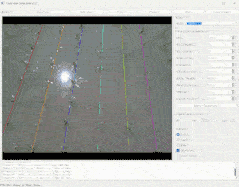
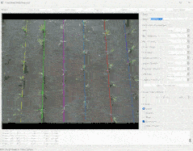
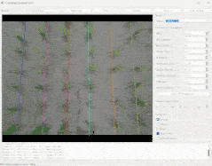
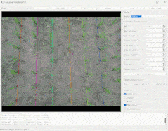
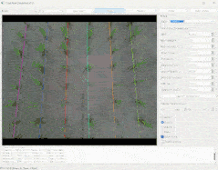
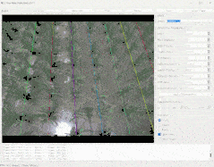
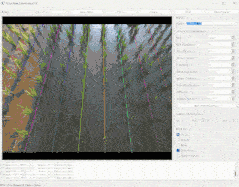
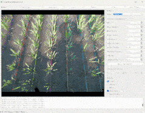

# CGMFNet

CGMFNet is an RGB-D semantic segmentation model for rice seedling and crop-row
detection in paddy fields. It uses paired RGB and depth images to improve
segmentation under challenging conditions such as illumination changes,
water-surface reflections, occlusion, and missing seedlings.

The repository also includes a crop-row detection application and multiple
baseline methods for comparison.

## Demonstrations

<table>
  <tr>
    <th width="25%">Demo 1</th>
    <th width="25%">Demo 2</th>
    <th width="25%">Demo 3</th>
    <th width="25%">Demo 4</th>
  </tr>
  <tr>
    <td align="center"></td>
    <td align="center"></td>
    <td align="center"></td>
    <td align="center"></td>
  </tr>
  <tr>
    <th width="25%">Demo 5</th>
    <th width="25%">Demo 6</th>
    <th width="25%">Demo 7</th>
    <th width="25%">Demo 8</th>
  </tr>
  <tr>
    <td align="center"></td>
    <td align="center"></td>
    <td align="center"></td>
    <td align="center"></td>
  </tr>
</table>

## Main components

- **CMGE:** performs adaptive interaction and enhancement between RGB and depth
  features.
- **MAAF:** fuses multi-level features in the network skip connections.
- **CGMFNet-L1 to CGMFNet-L4:** provide different model sizes for different
  accuracy and deployment requirements.
- **Crop-row detection:** extracts seedling positions from RGB-D data and fits
  crop-row lines.

## Repository structure

```text
CGMFNet/
|-- archs.py
|-- CMGE.py
|-- MAAF.py
|-- dataset.py
|-- losses.py
|-- metrics.py
|-- utils.py
|-- train.py
|-- val.py
|-- evaluate.py
|-- crop_row_detection.py
|-- inputs/
|-- models/
|-- requirements.txt
|-- requirements-gui.txt
`-- baselines/
```

## Installation

Install the dependencies required for training and evaluation:

```bash
pip install -r requirements.txt
```

Install the additional dependencies for the RealSense crop-row application:

```bash
pip install -r requirements-gui.txt
```

Each baseline project has its own `requirements.txt`.

## Dataset structure

RGB images, depth images, and masks must use matching file names.

```text
inputs/
`-- SeedingImg/
    |-- images/
    |-- depths/
    |-- rgb_masks/
    |   `-- 0/
    `-- depth_masks/
        `-- 0/
```

Only sample files are included in this repository. Replace them with your own
dataset before training.

## Training

Run the default CGMFNet-L4 configuration:

```bash
python train.py
```

Select another model variant when needed:

```bash
python train.py --name CGMFNet-L1 --arch CGMFNetL1
python train.py --name CGMFNet-L2 --arch CGMFNetL2
python train.py --name CGMFNet-L3 --arch CGMFNetL3
python train.py --name CGMFNet-L4 --arch CGMFNetL4
```

The options in `parse_args()` have default values. You can edit these defaults
and run the source file directly in an IDE, or override them from the command
line.

Training saves the checkpoint, log, and experiment configuration under:

```text
models/<experiment-name>/
|-- config.yml
|-- log.csv
`-- model.pth
```

## Validation and evaluation

```bash
python val.py --name CGMFNet-L4
python evaluate.py --name CGMFNet-L4
```

Both scripts read `models/<experiment-name>/config.yml`. This file is generated
automatically during training and should be kept with its corresponding
checkpoint.

## Pretrained models

Checkpoints for CGMFNet-L1, CGMFNet-L2, CGMFNet-L3, and CGMFNet-L4 are
included in the repository.

Baseline checkpoints are not all included, as some weight files are too large
to upload. The corresponding baseline source code and training scripts are
available under `baselines/`.

## Crop-row application

Run the graphical crop-row detection application with:

```bash
python crop_row_detection.py
```

The application supports RealSense bag playback and live-camera input. The GUI
can display RGB and depth images, segmentation masks, seedling positions, and
fitted crop-row lines.

## Citation

Citation information will be added after the associated paper is published.
